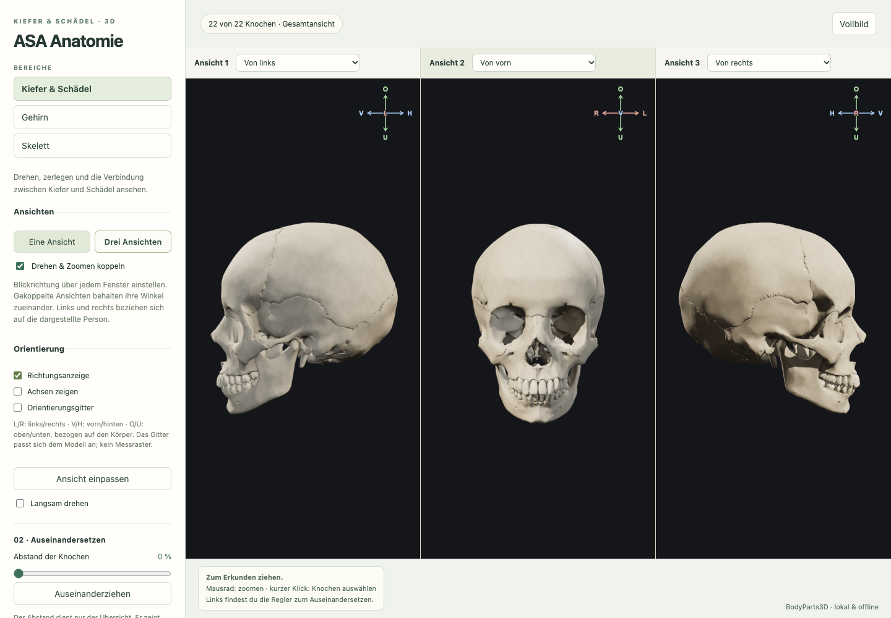
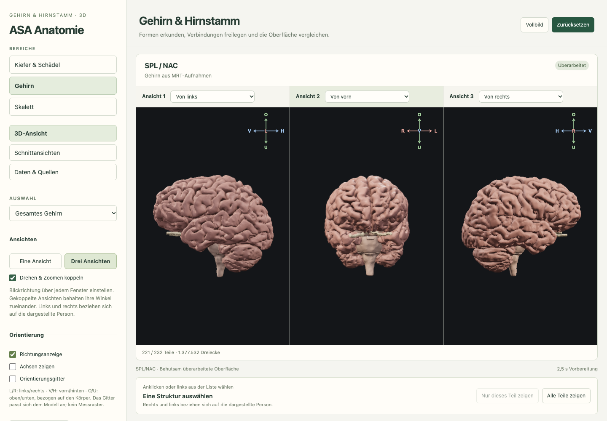
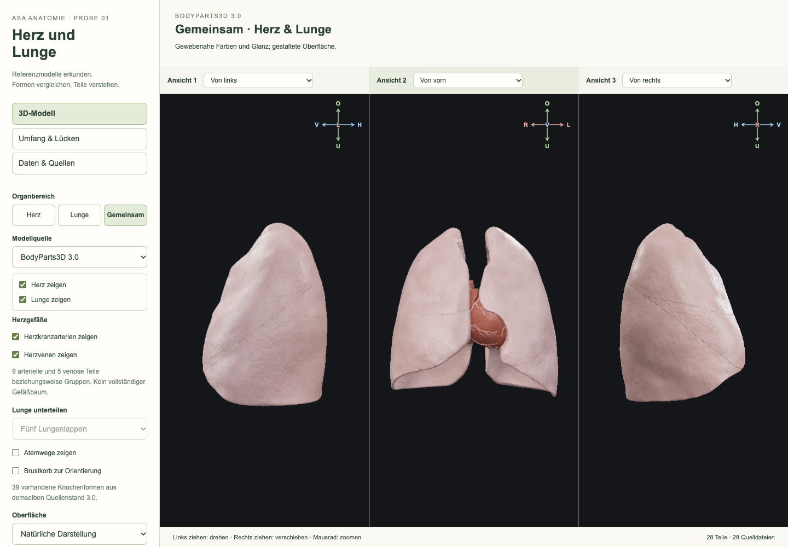

# ASA Anatomie

Menschliche Anatomie räumlich erkunden und nachvollziehbar verstehen.

Stand: 10.10.2026 · In Entwicklung

Dieses öffentliche Repository stellt das Vorhaben vor. Der Programmcode und die internen Entwicklungsunterlagen bleiben im privaten Hauptprojekt. Eine veröffentlichte Desktop- oder Mobil-App steht noch nicht bereit.

## Worum es geht

ASA Anatomie soll den menschlichen Körper schrittweise als zusammenhängendes, fein gegliedertes Modell zugänglich machen. Einzelne Strukturen lassen sich auswählen, ausblenden, in mehreren Ansichten betrachten und für das räumliche Verständnis auseinanderziehen.

Ein allgemeines Referenzmodell bildet die Grundlage. Später sollen daraus getrennte persönliche Varianten anhand geeigneter eigener Bildaufnahmen entstehen können. Das Referenzmodell und eine individuelle Rekonstruktion bleiben dabei eindeutig unterscheidbar.

## Was bereits vorhanden ist

- Kiefer und Schädel, Gehirn mit Hirnstamm sowie ein Referenzskelett im lokalen Browser-Prototyp.
- Eine oder drei gekoppelte 3D-Ansichten mit einstellbaren Blickrichtungen.
- Auswahl einzelner Teile, Ein- und Ausblenden sowie auseinandergezogene Lernansichten.
- Dunkle Modellflächen, Lernfarben, Oberflächennetze und schaltbare Orientierungshilfen.
- Gekoppelte MRT-Schnittansichten eines veröffentlichten Referenzatlas.
- Getrennte Entwicklungsproben für Herz und Lunge sowie die Untersuchung feiner Herzstrukturen anhand veröffentlichter Originaldaten.

Die getrennten Proben sind noch keine vollständig integrierten Funktionen. Ein Quellenmodell wird nur mit seinen nachgewiesenen Teilen und bekannten Grenzen beschrieben.

## Bilder aus der Anwendung

Echte Bildschirmaufnahmen des lokalen Entwicklungsstands vom 10.10.2026. Die Bilder zeigen allgemeine Referenzmodelle und keine persönlichen Aufnahmen des Projektinhabers.

Kiefer und Schädel in der Hauptanwendung. Modellgrundlage: BodyParts3D 3.0, © The Database Center for Life Science, CC BY-SA 2.1 Japan. Die Oberflächenfarben und feinen Texturen sind gestaltet.

Gehirn und Hirnstamm in der Hauptanwendung. Modellgrundlage: SPL/NAC Brain Atlas, hier mit der gekennzeichneten begrenzten Oberflächenbearbeitung. Quelle und Mitwirkende: [Open Anatomy](https://www.openanatomy.org/atlas-pages/atlas-spl-nac-brain.html).

Herz und Lunge in einer separaten Entwicklungsprobe. Modellgrundlage: BodyParts3D 3.0, © The Database Center for Life Science, CC BY-SA 2.1 Japan. Gewebefarben und Oberflächenwirkung sind gestaltet; diese Probe ist noch kein Organbereich der Hauptanwendung.

Die Bildschirmaufnahmen 01 und 03 werden unter [CC BY-SA 2.1 Japan](https://creativecommons.org/licenses/by-sa/2.1/jp/) bereitgestellt. Für die im Gehirnbild verwendeten Atlasanteile gilt die 3D-Slicer-Lizenz. Vollständige Hinweise zu Quellen, Mitwirkenden und Bearbeitungen stehen in [BILDQUELLEN.txt](BILDQUELLEN.txt).

## Was geplant ist

- Weitere Organe und eine feinere, überprüfbare Darstellung des Herzinneren.
- Muskulatur, Nervensystem, Arterien, Venen und Lymphsystem als getrennt schaltbare Bereiche.
- Nachvollziehbare räumliche Zuordnung der unterschiedlichen Referenzdaten.
- Lokale Verarbeitung geeigneter eigener Bildaufnahmen mit erhaltenem Original und getrennten Bearbeitungsschritten.
- Installierbare Desktop- und Mobil-Apps; eine zusätzliche Web-Ausgabe bleibt möglich.

Die Plattformarchitektur wird vor dem weiteren Ausbau festgelegt. Es gibt noch keine Zusage für bestimmte Geräte, Veröffentlichungstermine oder einen identischen Funktionsumfang auf allen Plattformen.

## Qualität und Daten

Anatomische Genauigkeit und eine realistische Oberfläche sind unterschiedliche Aufgaben. Eine schönere Darstellung beweist keine zusätzliche anatomische Information. Herkunft, Maßstab, Bearbeitung und offene Grenzen sollen deshalb nachvollziehbar bleiben.

Die Entwicklung verwendet unter anderem veröffentlichte Daten aus BodyParts3D, dem SPL/NAC Brain Atlas und weiteren getrennt untersuchten Referenzquellen. Die jeweiligen Quellenangaben und Nutzungsrechte bleiben erhalten. Dieses Info-Repository verteilt keine Atlasmodelle oder medizinischen Bilddatensätze.

Der vorhandene Prototyp lässt sich lokal ohne Internet benutzen. Für den weiteren Ausbau ist eine lokale Arbeitsweise vorgesehen. Dieses öffentliche Repository enthält keine persönlichen Aufnahmen oder Befunde. Eigene Gesundheitsdaten sollen nicht über öffentliche GitHub-Beiträge geteilt werden.

## Entwicklungsstand und Grenzen

ASA Anatomie ist ein Entwicklungsprojekt zum Erkunden und Lernen. Die vorhandenen Modelle sind nicht für Diagnose, Operationsplanung oder andere medizinische Entscheidungen validiert. Persönliche Rekonstruktionen und eine genaue Zuordnung individueller Implantate sind noch nicht umgesetzt.

## Dieses Repository

Die Beschreibung steht in `README.md`. `index.html` wird daraus mit `node scripts/render-info.mjs` erzeugt und kann lokal im Browser geöffnet werden. Node.js ist das Werkzeug zum Ausführen dieses Erzeugungsskripts. Bilder werden ausschließlich aus dem eigenen Ordner `bilder/` geladen. Die Infoseite enthält keine externen Schriftarten oder Analysewerkzeuge. GitHub Pages ist nicht eingerichtet.
